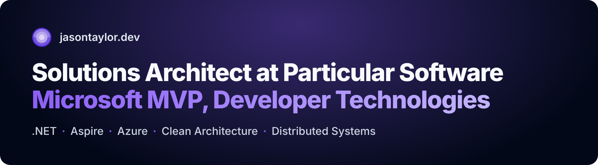

<p align="center">
  <a href="https://jasontaylor.dev"></a>
</p>

## Hi, I'm Jason 👋

I'm a Solutions Architect & Software Engineer at [Particular Software](https://particular.net), the team behind NServiceBus, and a [Microsoft MVP](https://mvp.microsoft.com/en-US/MVP/profile/4df6e9b2-396f-ed11-81ab-000d3a5600fa) in Developer Technologies. I've spent 25 years building software across legal, government, logistics, financial services, and education, and these days I focus on cloud-based applications with .NET and Azure.

I created and maintain the [Clean Architecture Solution Template](https://github.com/jasontaylordev/CleanArchitecture), and I speak at conferences and user groups about architecture, distributed systems, and getting from code to cloud.

## Start here

The quickest way to see what I work on is to run it:

```bash
dotnet new install Clean.Architecture.Solution.Template
dotnet new ca-sln -f net11.0 -o MyApp
cd MyApp
dotnet run --project src/AppHost
```

That gives you an ASP.NET Core solution on .NET 11 (or .NET 10 with `-f net10.0`), orchestrated with Aspire. The [documentation](https://cleanarchitecture.jasontaylor.dev) covers the architecture and every feature.

## Projects

| Project | What it is | |
| --- | --- | --- |
| [**CleanArchitecture**](https://github.com/jasontaylordev/CleanArchitecture) | Clean Architecture Solution Template for ASP.NET Core, with an Angular or React front end, or Web API only. [Docs](https://cleanarchitecture.jasontaylor.dev) |  |
| [**RapidConsole**](https://github.com/jasontaylordev/RapidConsole) | Command-line application template for .NET with commands, dependency injection and logging. |  |
| [**flexible-aspnetcore-authorization**](https://github.com/jasontaylordev/flexible-aspnetcore-authorization) | Permission-based authorization for ASP.NET Core. Sample code and slides from my talk. |  |
| [**azd-blazor**](https://github.com/jasontaylordev/azd-blazor) | Azure Developer CLI starter for a Blazor web app with a SQL database, hosted on Azure. |  |
| [**Effortless**](https://github.com/jasontaylordev/Effortless) | Sample code for my talk on distributed systems with Aspire, NServiceBus and the Azure Developer CLI. |  |

## Latest writing

<!-- BLOG-POST-LIST:START -->
- [Clean Architecture Template 11.0.0: .NET 10 and .NET 11 Side by Side](https://jasontaylor.dev/clean-architecture-template-11-0-0-net-10-and-net-11-side-by-side/)
- [Clean Architecture Template 10.8.0 Released](https://jasontaylor.dev/clean-architecture-template-10-8-0-released/)
- [Rebuilding My Windows Development Environment](https://jasontaylor.dev/rebuilding-my-windows-development-environment/)
<!-- BLOG-POST-LIST:END -->

More at [jasontaylor.dev](https://jasontaylor.dev), where you can also subscribe for template releases and new posts.

## Recent talks

- [Effortless Distributed Systems with Aspire](https://www.youtube.com/watch?v=DvbW4q1d7F4), Particular Software, 2026
- [Effortless Distributed Systems with .NET Aspire](https://youtu.be/2xhfFdcjUNA), JetBrains .NET Days Online, 2025
- [Speedrunning Code to Cloud with the Azure Developer CLI](https://www.youtube.com/watch?v=H673b4bUt6E), Microsoft Reactor, 2025
- [Unleashing Clean Architecture in .NET 8](https://youtu.be/yB01HaG0i0w), Copenhagen Developers Festival, 2023

The full list is on my [speaking page](https://jasontaylor.dev/speaking/), and the recordings are collected on [YouTube](https://www.youtube.com/@JasonTaylorDev).

## Find me

[Blog](https://jasontaylor.dev) · [LinkedIn](https://www.linkedin.com/in/jasontaylordev) · [Bluesky](https://bsky.app/profile/jasontaylor.dev) · [X](https://x.com/jasontaylordev) · [YouTube](https://www.youtube.com/@JasonTaylorDev) · [Sessionize](https://sessionize.com/jasontaylordev)
